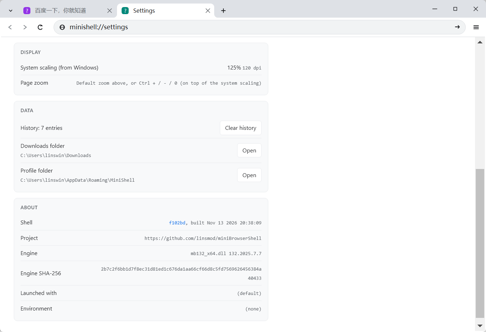
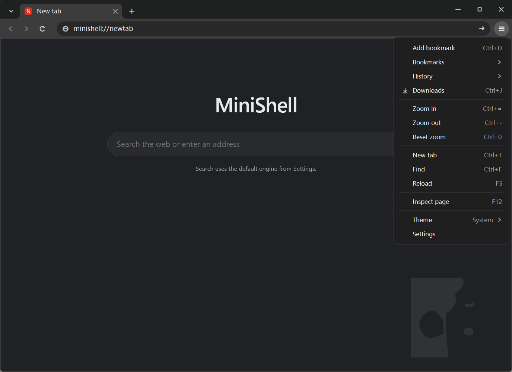

# MiniShell

miniblink 132 的桌面浏览器外壳：标签条、地址栏、菜单、设置页全部自绘，
页面渲染、输入、IME、网络交给 `mb132_x64.dll`。功能与构建说明见
[browsershell/README.md](browsershell/README.md)。

产物是 `browsershell\build-msvc\Release\minishell.exe`（和 `minishell.pdb` 一起分发，
崩溃报告要用它解析符号），`mb132_x64.dll` 放在 exe 旁边。

## 设置页（浅色）

- 标签条、新标签页按钮、右上角窗口按钮都是外壳自己画的，不依赖系统标题栏。
- `minishell://settings` 是适配层生成的内部页：主题、搜索引擎、页面缩放、启动时行为都在这里。
- About 是报告问题需要的版本信息；`Shell` 后面的版本号（如 `f102bd`）是指向 GitHub 上对应
  commit 的链接，下面是引擎版本和 `mb132_x64.dll` 的 SHA-256。

## 新标签页 + 主菜单（深色）

- 深色主题跟随系统（也可以在设置里固定为浅色/深色）。
- 搜索框回车走设置里的默认搜索引擎；输入的是网址就直接导航。
- `☰` 菜单同样是自绘的：书签、历史、下载、缩放、查找、检查元素、主题、设置，快捷键标在右侧。

两张都是实际运行的截图（Windows 11，125% 缩放，构建 `f102bd`）。
